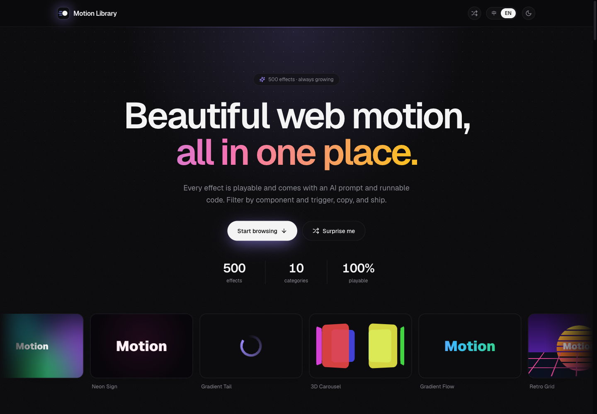
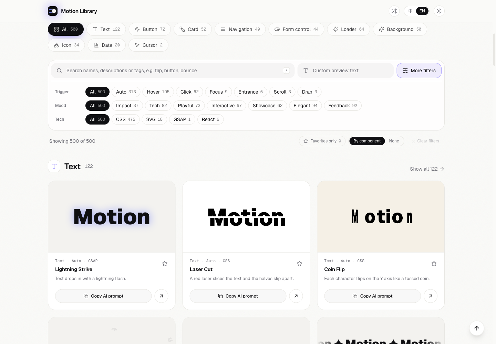
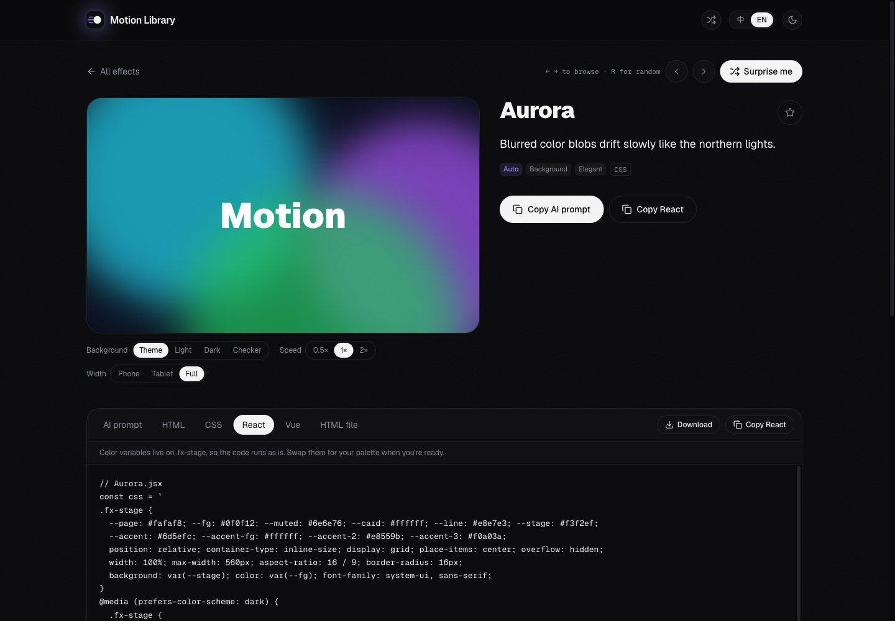

# Motion Library

A collection of 500 web animation effects you can search, filter and try out in the browser. Each effect comes with an AI prompt you can paste into your coding assistant, plus ready-to-run HTML, CSS, React and Vue code.

Built with Next.js, React, TypeScript and Tailwind CSS. The interface is available in Simplified Chinese and English, with light and dark themes.

## Preview

**Dark mode · English**

**Light mode · Search and filters**

**Effect details · Live preview and code export**

## From idea to code

1. **Find an effect.** Search by name or tag, combine filters, or use “Surprise me” to explore.
2. **Try it out.** Open the effect page and change the preview background, speed or width. Test hover, click and drag effects directly.
3. **Make it yours.** Copy the AI prompt into your coding assistant, or copy/download HTML, CSS, React, Vue or a standalone HTML file. Adjust the included color variables to match your project.

## The collection

| Category | Effects |
| --- | ---: |
| Text | 122 |
| Buttons | 72 |
| Cards | 52 |
| Navigation | 40 |
| Form controls | 44 |
| Loaders | 64 |
| Backgrounds | 50 |
| Icons | 34 |
| Data | 20 |
| Cursors | 2 |
| **Total** | **500** |

## Features

**Browsing**

- 500 effects in ten categories: text, buttons, cards, navigation, form controls, loaders, backgrounds, icons, data and cursors.
- Search in either language, and filter by component, trigger (auto, hover, click, focus, enter, scroll, drag), context and technique. Each filter shows how many results it would give.
- Filters are kept in the URL, so a link like `/?c=button&t=hover` opens the same results for anyone.
- Star effects to save them as favorites, and show only your favorites with one click.
- Recently viewed effects (up to 20) appear at the top of the home page.
- "Surprise me" opens a random effect, from the top bar or with the `R` key.

**Effect pages** (`/effects/<id>`)

- A large live preview. Hover, click and focus effects play an auto demo until you move the pointer over them.
- Preview tools: background (theme, light, dark, checkerboard), speed (0.5×, 1×, 2×) and width (phone, tablet, full).
- A code panel with separate tabs for the AI prompt, HTML, CSS, React, Vue and a standalone HTML file. Each tab can be copied, and the code files can be downloaded. Exported code includes the color variables it needs, so it runs as is.
- Previous / next links, `←` / `→` to move between effects, and related effects at the bottom.

**Everything else**

- Only the language you pick is shown: switching changes the interface, effect names, AI prompts and page titles. First visits follow the browser's language.
- Light, dark or system theme, remembered between visits and applied without a flash.
- Previews only render while on screen, and looping animations pause when scrolled away.
- Share images (Open Graph) use a real screenshot of each effect. A sitemap and robots.txt are generated.
- Keyboard navigation and the system's reduced-motion setting are supported.

## Keyboard shortcuts

| Key | Action |
| --- | --- |
| `/` | Focus search on the library page |
| `Esc` | Clear search |
| `R` | Open a random effect |
| `←` / `→` | Open the previous / next effect on a detail page |
